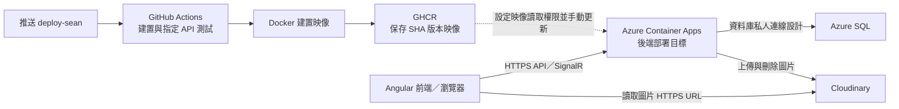

**GoHike 雲端部署技術總結：組員問答版**

依目前 `deploy-sean` 分支的程式、GitHub Actions 與部署文件整理。程式與 workflow 可以確認的實作，和需要在 Azure 上操作、驗收的項目，以下分別交代；本次未登入 Azure 查核正式資源狀態。

依部署者確認，實際部署未使用 Azure Files；架構與流程已依此修正。圖片使用 Cloudinary，Data Protection 金鑰的外部持久化則尚未確認。

**約一分鐘的口頭說明**

> 我們的後端使用 ASP.NET Core 10，先透過 Docker 將程式與執行環境封裝成映像，降低本機與雲端環境不同造成的問題。程式推送到部署分支後，GitHub Actions 會自動建置、執行指定的 API 測試，再把映像發布到 GitHub Container Registry，並用 Git commit SHA 標示版本。
>
> 雲端部署方案使用 Azure Container Apps 執行後端、Azure SQL 儲存業務資料，圖片則由 Cloudinary 儲存與提供 HTTPS 網址。資料庫連線與 API 金鑰透過部署環境的 secrets 和環境變數提供。更新映像後，還要檢查健康端點、資料庫連線及主要功能。
>
> 目前自動化做到測試與映像發布；Azure 端的映像更新仍是手動操作。部署設計也包含資料庫私人連線、自訂網域與 HTTPS，實際啟用狀態須以 Azure 環境驗收結果為準。

**整體架構與各服務分工**

| 技術／服務 | 在本專案的角色 | 可以確認的範圍 |
| --- | --- | --- |
| ASP.NET Core 10 | 提供 REST API、MVC 與 SignalR | 專案目標框架為 `net10.0` |
| Docker | 封裝後端與執行環境 | 根目錄已有多階段 Dockerfile |
| GitHub Actions | 自動建置、執行指定測試、發布映像 | 已有 workflow；執行成功與否仍看各次 Actions 紀錄 |
| GHCR | 保存 Docker 映像 | 現行 workflow 的發布目標 |
| Azure Container Apps | 執行後端容器 | 部署文件指定的平台；本次未查核線上狀態 |
| Azure SQL | 儲存會員、活動、步道等業務資料 | 後端使用 EF Core SQL Server；雲端搬遷步驟已有文件 |
| Cloudinary | 儲存、刪除圖片並回傳 HTTPS URL | 活動照片與會員頭像已有程式實作 |

**部署流程，依序說明**

1. **先整理可以在雲端啟動的後端。**

   後端從設定系統讀取 SQL 連線、JWT、Cloudinary 等值。正式環境以 secrets 和環境變數提供，例如 `ConnectionStrings__GoHikeDataContext`、`JwtSettings__SecretKey`。本機 User Secrets 不會自動帶進部署環境。JWT 的金鑰、Issuer、Audience 缺漏，或金鑰不足 32 bytes，程式會拒絕啟動。

2. **用 Docker 多階段建置產生映像。**

   第一階段使用 .NET 10 SDK 執行套件還原與 Release publish；第二階段使用 ASP.NET 10 執行環境，放入發布結果。容器監聽 `8080`，並以非 root 使用者執行。`.dockerignore` 排除本機建置產物、開發工具目錄及 `.env` 等檔案；機密仍須由部署環境管理。

3. **透過 GitHub Actions 檢查與發布。**

   Push 到 `deploy-sean` 時，workflow 先執行後端 Release build 和 `tests/GoHikeSafeApiTests`，再建置 Docker 映像，使用 `GITHUB_TOKEN` 發布到 `ghcr.io/<owner>/<repository>:<commit SHA>`。SHA 讓映像可以對應到原始碼版本，方便追查問題與選擇回復版本。PR 也會建置、執行上述測試及建置容器，但不發布映像。

   這組 API 測試包含路由、驗證、JWT 授權、回應資料等檢查，使用資料庫替身；不能把它說成已驗證正式 Azure SQL 或整個正式系統。

4. **準備 Azure 的運算與資料庫環境。**

   部署文件規劃在 Azure 建立資源群組、VNet、Container Apps 環境和 Azure SQL。SQL 搬遷使用 BACPAC 匯出／匯入既有 schema 與資料，再比對並套用尚未執行的增量 SQL 腳本。程式啟動時不會自動套用 EF migrations。

   網路設計讓 Container Apps 經 VNet、Private Endpoint 與 Private DNS 連到 SQL；先驗證名稱解析、TCP 1433 與 SQL 登入，再關閉 SQL 公開網路存取。應用程式則使用專用低權限 SQL 帳號。這些是文件中的部署步驟，完成狀態需由 Azure 設定與驗收紀錄佐證。

5. **設定 secrets、跨來源與 Cloudinary 圖片儲存。**

   在 Container App 設定 Production 環境、SQL 連線、JWT、圖片與寄信等功能所需參數。CORS 以 `Cors__AllowedOrigins` 指定前端 origin；正式環境沒有設定時不允許跨來源瀏覽器請求。部署文件也要求處理 Azure ingress 的 HTTPS 轉送資訊，讓應用程式正確判斷外部請求協定。

   最新活動照片流程已改成「後端上傳 Cloudinary → SQL 保存圖片 URL → 前端直接讀取 URL」，新圖片不依賴容器本機磁碟。舊的 `/assets/JoinGroup_Images/` 圖片仍保留相容處理，若正式資料還使用這類路徑，就要另外保留舊檔案。

   Data Protection 金鑰用於保護重設密碼、信箱驗證等資料。程式保留 `DataProtection__KeysPath` 自訂目錄的支援，但實際部署未使用 Azure Files，其他外部持久化設定也尚未確認。Dockerfile 建立 `/app/dpkeys` 本身不代表金鑰會跨 revision 保存，因此不將金鑰持久化列為已完成的部署成果。

6. **手動將指定映像更新到 Container Apps。**

   現行 Actions 只把映像送到 GHCR，沒有執行 Azure 更新。Azure 端必須先具備讀取該映像的權限，再選擇指定 SHA 的映像部署，產生新的 revision。

   舊部署文件也包含建立 ACR、讓 Container App 從 ACR 拉取映像的初始化步驟。ACR 和 GHCR 是兩個不同的映像倉庫；目前 workflow 不會把 GHCR 映像同步到 ACR，也不會自動替 Azure 切換 registry。說明時以實際 Azure registry 設定為準。

7. **驗收服務，再處理對外網域。**

   程式提供 `/health/live` 確認應用程式能回應，及 `/health/ready` 檢查資料庫能否連線；後者在連線失敗時回傳 `503`。部署後還須驗證 SQL 讀寫、JWT 登入、照片上傳、信箱驗證／重設密碼，以及 SignalR 即時連線。健康檢查端點已實作；平台探針是否設定完成，需查 Azure。

   文件規劃透過 DNS CNAME、TXT 驗證及 Container Apps managed certificate 綁定 `gohike-cloud.clam.tw`。這是文件指定的目標網域，本次未確認 DNS 與憑證的線上狀態。

**老師或面試官常問的問題**

| 問題 | 組員可以這樣回答 |
| --- | --- |
| 為什麼使用 Docker？ | 將程式與指定的執行環境一起封裝，讓建置與部署方式一致，降低不同電腦或伺服器環境造成的差異。 |
| GitHub 和 Azure 分別做什麼？ | GitHub 保存程式碼並執行自動建置與測試，GHCR 保存映像；Azure Container Apps 是部署方案中實際執行後端的地方。 |
| 你們有 CI/CD 嗎？ | 已建立自動建置、指定 API 測試與映像發布；Azure 部署更新仍需手動完成，因此目前不能宣稱完整自動部署。 |
| 資料庫如何搬上雲端？ | 文件規劃以 BACPAC 搬移既有資料與結構，再核對增量 SQL 腳本，並設定正式連線與私人網路。是否已搬完，要依實際驗收結果回答。 |
| 更新容器後照片會消失嗎？ | 最新活動照片及頭像存放於 Cloudinary，資料庫保存網址；舊的容器本機照片則需要另外保留檔案。 |
| 有使用 Azure Files 嗎？ | 沒有。實際部署的活動照片與頭像使用 Cloudinary；Azure Files 不在現行部署架構中。 |
| 驗證或重設密碼連結在重新部署後還有效嗎？ | 程式有 Data Protection，但尚未確認金鑰的外部持久化設定，因此跨 revision 的有效性須以實測結果回答。 |
| 出問題如何回復？ | 以 SHA 找到先前的映像，再用 Container Apps revision／映像更新機制回復應用程式；資料庫結構與資料必須另外安排備份及回復。 |
| 為什麼先使用一個副本？ | 文件第一階段固定單副本；Session 與 SignalR 有容器內狀態，增加副本前須處理 Session 共享與 SignalR 跨副本通訊。這不代表已完成高可用設計。 |
| 背景工作也在雲端運作嗎？ | 專案有 Hangfire 整合，但第一階段部署設定為 `Hangfire__Enabled=false`，不能直接說已啟用雲端背景工作。 |
| 前端部署在哪裡？ | 此 repository 可確認 Angular 串接需求、CORS 與 SignalR 後端；前端正式主機與發布流程不在這份設定中，須以其部署專案為準。 |

**這項部署工作的技術價值**

可以向評審說明，這項工作將後端從本機執行推進到可重複建置、可識別版本、可設定正式環境並具備健康檢查的部署流程。主要貢獻包括 Docker 容器化、GitHub Actions 自動化、映像版本管理、正式環境設定與機密管理、圖片外部儲存，以及 Azure 網路、資料庫搬遷和部署驗收流程的設計。

**程式與文件依據**

- [Dockerfile](../../Dockerfile)
- [GitHub Actions workflow](../../.github/workflows/docker.yml)
- [應用程式啟動與正式環境設定](../Program.cs)
- [Azure Container Apps 部署文件](Azure_Container_Apps_部署.md)
- [活動圖片 API 與 Cloudinary 設定](EventPhotos_api.md)
- [CloudinaryService](../Services/forum/CloudinaryService.cs)
- [API 測試程式](../../tests/GoHikeSafeApiTests/Program.cs)
